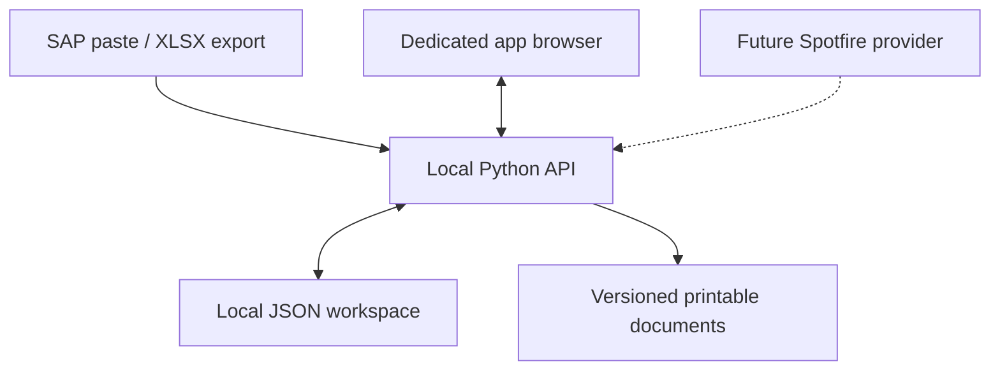

# Architecture

## Current runtime

The app has no required third-party Python packages. The Python API owns all business decisions. The browser resolves HUs for immediate feedback, then the API repeats the relevant validation when a completed form is saved. Client-side validation is not the authority.

Requests that change data carry the state revision. A re-entrant lock serialises mutations inside the server; a file lock prevents another app process using the same data directory. Each action runs against a deep copy. The replacement file is flushed and atomically renamed only after the entire action succeeds. Failure while finalising a pallet cannot leave a half-created form or pallet. A previous-state copy is retained.

Source imports replace one source dataset at a time. Completed forms capture their resolved values and import timestamps. Replacing imports never rewrites those saved forms. Editing an automatic form explicitly re-resolves it against the current data. Finalising an existing pallet validates its completed saved forms rather than requiring the HUs to still exist in the latest export.

Form revisions are immutable completed snapshots. Pallet revisions contain snapshots of the forms included when finalised. Reopening preserves the prior revision and appends an event. The print endpoint marks an outdated, removed or reopened record's document superseded. Activity entries record the local preparer label and time, not an authenticated actor.

## Later integrations

### Spotfire

`integrations/spotfire.py` is deliberately unavailable. The future provider should produce the same normalised records as `parse_table`:

- Ship-to: `hu`, `document`, `dn`, `shipTo`, `condition`, `externalId`.
- Quantities: `hu`, `document`, `qty`, retaining separate material rows.

Manual sign-in and a visible controlled browser belong to that provider. No Spotfire URL, credentials or automated login are embedded now. Report freshness and export availability must be established before enabling it.

### Supabase and QR

The next phase should replace the local store through a repository/service boundary while retaining domain validation. Keep privileged keys on trusted services. The driver website should operate on scoped, unpredictable pallet/trip capabilities through validated server-side operations, rather than unrestricted anonymous table writes.

Pallet finalisation is the natural revision boundary for a QR capability. Reopening must revoke the old capability before edits, then generate a new one when finalised again. Existing documents and event history should remain available. Driver trips, grouped collection and destination-specific delivery confirmation are not implemented in this phase.

### Printing and archiving

Both HTML preview and native Windows printing use the same `document_model` generated from saved snapshots. Consolidated output contains no child-form IDs; entirely empty optional part/description columns are omitted. The final document includes a labelled QR placeholder, not a scannable tracking code.

`native_print.py` serialises document data to a temporary JSON file and invokes a fixed Windows PowerShell command. It never interpolates document text or printer names into executable code. The bundled C# renderer uses `System.Drawing.Printing.PrintDocument` and `StandardPrintController` to submit without a browser or print dialog. A4, simplex and collated application-generated copies are used. Leaving the printer setting empty follows the current Windows default; an explicit printer name affects only that job. PDF/XPS virtual printers receive an output filename.

The native renderer wraps long cells, splits oversized rows, repeats table headers and paginates remarks. The Windows-only automated test compiles and exercises this renderer into a bitmap without submitting a real print job. The remaining submission tests mock Windows, including copy counts, printer choice, duplicate request handling and error preservation. Physical printing still requires workstation acceptance.

Saving/finalising commits before print submission. Failure leaves saved work available. Successful print request IDs are cached in the running app to avoid duplicate submission after a lost response. Queue submission is logged separately from the shipment state. The app does not retry failures automatically and never changes the system default printer. Signature capture and SharePoint uploads remain deferred.

## Appearance and source grids

Settings migrate existing workspaces to Light appearance, one open-form copy, two final-pallet copies and the live Windows default printer. Theme changes preserve printer/origin settings. CSS surface/text tokens cover both light and dark appearances; printed documents remain light.

SAP cell grids accept tabular clipboard data at the focused cell, preserve identifiers as text, handle quoted multiline cells, and paginate large input datasets. Header pastes replace the grid; data-only pastes use the prefilled SAP headers. Preview/apply still goes through the same server-side validation as file imports.
