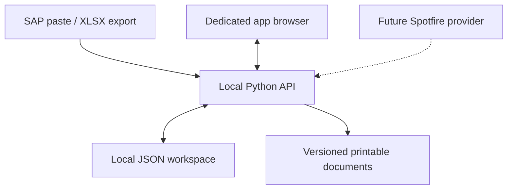

# Architecture

## Current runtime

The app has no required third-party Python packages. The Python API owns all business decisions. The browser resolves HUs for immediate feedback, then the API repeats the relevant validation when a completed form is saved. Client-side validation is not the authority.

Requests that change data carry the state revision. A re-entrant lock serialises mutations inside the server; a file lock prevents another app process using the same data directory. Each action runs against a deep copy. The replacement file is flushed and atomically renamed only after the entire action succeeds. Failure while finalising a pallet cannot leave a half-created form or pallet. A previous-state copy is retained.

Source imports replace one source dataset at a time. Completed forms capture their resolved values and import timestamps. Replacing imports never rewrites those saved forms. Editing an automatic form explicitly re-resolves it against the current data. Finalising an existing pallet validates its completed saved forms rather than requiring the HUs to still exist in the latest export.

Form revisions are immutable completed snapshots. Pallet revisions contain snapshots of the forms included when finalised. Reopening preserves the prior revision and appends an event. The print endpoint marks an outdated, removed or reopened record's document superseded. Activity entries record the local preparer label and time, not an authenticated actor.

## Later integrations

### Spotfire

`integrations/spotfire.py` is deliberately unavailable. The future provider should produce the same normalised records as `parse_table`:

- Ship-to: `hu`, `document`, `dn`, `shipTo`, `condition`, `externalId`.
- Quantities: `hu`, `document`, `qty`, retaining separate material rows.

Manual sign-in and a visible controlled browser belong to that provider. No Spotfire URL, credentials or automated login are embedded now. Report freshness and export availability must be established before enabling it.

### Supabase and QR

The next phase should replace the local store through a repository/service boundary while retaining domain validation. Keep privileged keys on trusted services. The driver website should operate on scoped, unpredictable pallet/trip capabilities through validated server-side operations, rather than unrestricted anonymous table writes.

Pallet finalisation is the natural revision boundary for a QR capability. Reopening must revoke the old capability before edits, then generate a new one when finalised again. Existing documents and event history should remain available. Driver trips, grouped collection and destination-specific delivery confirmation are not implemented in this phase.

### Printing and archiving

Printable HTML is generated from saved snapshots and escapes all user-supplied text. Browser print/PDF output is implemented; silent printing, signature capture and SharePoint uploads are not. If archival integration is added, record archive and physical-print outcomes independently from form saving.
